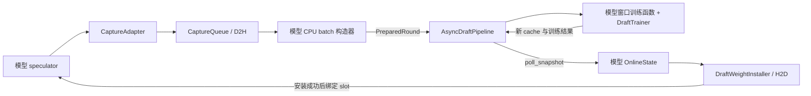

# 在线 draft 训练代码导航

这里实现 EAGLE3 和 DFlash 的请求内异步 CPU 在线训练。当前主路径使用单 GPU、
单活动请求：GPU 持续推理，后台采集线程搬运数据，后台训练线程更新 CPU draft，
推理线程在安全位置安装已完成上传的新权重。每个请求结束后恢复初始权重 W0。

本文对应结构重构后的代码。DFlash 的训练细节、运行参数与实验索引见
[DFlash 说明](docs/dflash/README.md)，两种方法的差异见
[EAGLE3 / DFlash 对比](docs/dflash/change_summary_eagle3_comparison.md)。

## 最终目录

```text
online_draft/
├── src/online_draft/
│   ├── models/                       # CPU 可微模型及 checkpoint 转换
│   │   ├── qwen3_eagle3.py
│   │   ├── qwen3_dflash.py
│   │   ├── cpu_attention.py           # CPU attention / autograd 接入
│   │   └── csrc/attention_backward.cpp
│   ├── runtime/                      # 采集、搬运、调度与权重交接
│   │   ├── contracts.py              # CapturePacket、PreparedRound
│   │   ├── capture/
│   │   │   ├── eagle3.py             # packet、adapter、CPU batch 构造
│   │   │   └── dflash.py             # 同上，另含 pinned staging
│   │   ├── transport.py              # capture FIFO、D2H、event、finish
│   │   ├── async_pipeline.py         # 训练 FIFO、窗口、snapshot、reset
│   │   ├── weights.py                # CPU snapshot、H2D installer
│   │   └── cpu_worker.py             # 各 CPU 角色的线程数及 affinity
│   └── training/
│       ├── trainer.py                # 公共 optimizer、step、W0、version
│       ├── eagle3/
│       │   ├── batch.py              # 单轮 batch 及有效性校验
│       │   ├── inputs.py             # 位置对齐、query 输入与 attention mask
│       │   ├── distill.py            # teacher 分布、监督权重与 KL
│       │   ├── cache.py              # detached context、确认历史 KV 追加
│       │   └── window.py             # 多轮窗口及训练入口
│       └── dflash/
│           └── window.py             # batch、cache、完整 block、loss、训练
├── scripts/                          # 实机 smoke、数学检查、trace 解析
├── tests/                            # CPU 模型、训练及运行时行为测试
└── docs/                             # 当前说明与历史实验报告

vllm/v1/worker/
├── gpu_worker.py                     # 在线组件的四处生命周期调用点
└── gpu/
    ├── online_draft.py               # create_online_draft / OnlineDraftRuntime
    └── spec_decode/
        ├── weight_slots.py           # 共用 GPU slot 分配和参数绑定
        ├── eagle/
        │   ├── online.py             # EAGLE3 安装、窗口关闭和 request reset
        │   └── speculator.py         # EAGLE3 推理与 capture hook
        ├── autoregressive/
        │   └── speculator.py         # EAGLE 等自回归推测解码共用路径
        └── dflash/
            ├── online.py             # DFlash 在线状态与派生权重 buffer
            ├── speculator.py         # DFlash 推理与 capture hook
            └── cudagraph.py          # DFlash query graph
```

目录树省略了 `__init__.py` 和无关的推理文件。`runtime/__init__.py` 只提供
`profile_range`，不承担运行时装配。DFlash 的 batch/cache/loss 当前都服务于同一个
窗口训练过程，继续放在 `training/dflash/window.py`；两种方法按同样的职责分组，
不要求内部文件数量相同。

## 按职责找代码

| 要处理的问题 | 代码位置 | 边界 |
| --- | --- | --- |
| 哪个时刻采集，记录什么 | 两种 `speculator.py` 与 `runtime/capture/` | 推理侧选 hook；adapter 保存 proposal、teacher 和版本，生成 packet |
| GPU 数据如何成为一轮训练样本 | `runtime/capture/` 的 packet 与 `_...BatchBuilder` | packet 定义复制布局；构造器对齐 prompt、确认历史和监督位置 |
| D2H 怎么执行，何时可以读 CPU 数据 | `runtime/transport.py` | 按 FIFO 等待 ready event、在 D2H stream 复制、等待完成后调用构造器 |
| 何时训练、哪些轮属于同一窗口 | `runtime/async_pipeline.py` | bootstrap、epoch close、训练队列及快照发布；不解释模型专用 batch |
| 一次更新计算什么 | `training/eagle3/`、`training/dflash/` | query 选择、mask、loss、context KV 构建与更新后的历史追加 |
| 如何做 backward / optimizer / reset | `training/trainer.py` | 持有 CPU 模型、optimizer、W0、可训练参数名和 CPU version |
| CPU 权重如何上传并生效 | `runtime/weights.py` | snapshot 数据与版本；installer stage、完成检查、active slot/version、reset |
| GPU 参数存储如何分配和绑定 | `spec_decode/weight_slots.py` | 只为选中的 draft 自有参数分配双 slot，保持 target 共享参数 |
| DFlash 派生参数如何保持一致 | `dflash/online.py` | 按 slot 维护 fused KV、norm buffer，并在 commit 前准备完成 |
| 谁组装上述对象 | `gpu/online_draft.py` | 选择模型和训练函数，连接回调，提供 worker 生命周期入口 |

`DFlashCaptureAdapter` 的 Adapter 指它把 vLLM 推理回调中的数据转换为采集协议。
它本身不训练模型。`capture/` 属于 `runtime/`，因为它依赖请求状态、GPU 完成事件、
异步队列及跨线程数据生命周期；其中的 CPU batch 构造器仍保留模型专用语义。

三个原有 weight 文件已合并为 `runtime/weights.py`，只保留
`DraftWeightSnapshot` 和 `DraftWeightInstaller` 两个主要对象。
领取快照直接使用 `pipeline.poll_snapshot` 回调，交接通过
`installer.advance(snapshot)` 完成。GPU 模型参数绑定仍留在 vLLM，避免训练包
依赖具体推理模型。

## 线程与数据所有权

| 执行位置 | 持有的状态 | 发出的数据 |
| --- | --- | --- |
| 推理线程 / GPU | adapter 的 proposal、teacher；在线状态；活动 slot；GPU KV | GPU packet + ready event，epoch close、finish 标记 |
| capture 线程 | `CaptureQueue`、D2H stream、CPU batch 构造器的连续历史 | 带 request/step/source version 的 `PreparedRound` |
| training 线程 | CPU 模型、optimizer、当前窗口、CPU 持久 KV | 已更新版本的 CPU snapshot |
| GPU H2D stream | installer 提交的复制与派生 buffer 准备 | 完成 event，由推理线程查询 |

H2D stream 不是额外的 Python 工作线程。Capture 等待 D2H 完成发生在采集线程；
推理侧安装只查询完成事件，不等待 CPU 训练或尚未完成的 H2D。
请求 finish/reset 则允许等待后台工作和上传完成。

DFlash staging 是复用的 pinned buffer。Batch 构造器必须在下一次搬运覆盖它之前，
把提交给训练线程的数据转成独立持有的内容。CPU snapshot 也复用一份 pinned
存储，但下一次训练由上次安装成功后的 epoch close 触发，因此不会在 H2D 仍读取
该快照时覆盖它。

## 一条完整调用链



装配入口是 [`create_online_draft`](../vllm/v1/worker/gpu/online_draft.py)。
它注入 EAGLE3 的 `train_eagle3_rounds` 或绑定参数后的 DFlash
`train_dflash_window`，所以 pipeline 不需要按模型分支。训练函数接收 trainer、
完整 round 的 batch 元组、旧 cache 和 profiling 开关，返回新 cache 与训练结果。

两种模型共用时序约束，但安装 hook 的具体位置不同：

```text
EAGLE3: capture 上一轮 packet → poll/stage/commit/bind
        → 安装成功则 close_epoch → 当前 FC / attention
DFlash: poll/stage/commit/bind → 当前 FC → capture target packet
        → 安装成功则 close_epoch → 当前 context KV / query
```

不能把这两个序列折叠成一个统一的“步前 hook”。Packet 必须先于对应的 epoch
标记进入 FIFO。第一条完整 round 携带 prompt bootstrap，单独训练一次；后续
只在新权重真正安装时关闭窗口。样本中的 `source_weight_version` 记录 proposal
生成时的 GPU 版本，CPU 训练版本可以领先于它。

[`gpu_worker.py`](../vllm/v1/worker/gpu_worker.py) 保留四处生命周期接入：

1. 模型加载后创建 `OnlineDraftRuntime`，完成装配，capture 此时尚未启用。
2. Warmup 完成后调用 `enable_capture()`，先应用 inference CPU 配置，再挂上 adapter。
3. 每次执行前传播后台错误，并处理已结束请求。Finish 经过 capture FIFO 和训练
   FIFO，等待已开始工作，丢弃未闭合窗口及不完整尾部，再恢复 CPU/GPU W0。
4. Shutdown 先关闭 capture，再关闭 pipeline，最后释放 model runner。

关闭在线训练时不创建上述 runtime、CPU 模型、工作线程或 capture buffer。

## 依赖与保留的差异

独立 `online_draft` 包不导入 vLLM。vLLM 的装配层和推理状态对象依赖训练包；
公共 transport 只依赖 packet 协议，公共 pipeline 只依赖训练回调、trainer 和
通用 round 元数据。模型的 batch/KV 细节留在模型自己的 capture 与 training 中。

`training` 和 `runtime` 不是完全单向的目录依赖：训练函数复用
`runtime.profile_range`，pipeline 调用公共 trainer；模块层面没有运行时导入环。
EAGLE3 cache 对 window 类型的引用在 `TYPE_CHECKING` 下，不会触发运行时循环。
DFlash CPU 模型目前复用 EAGLE3 文件内的 RMSNorm 和 RoPE 基础函数。

推理共用 slot，但 DFlash 仍需要派生 buffer 和每个 slot 一套 query graph。
当前 EAGLE3 在线 draft 使用 explicit input embeddings，走 eager draft 路径。
两种方法也保留各自的 loss、query 布局与 context 构建方式。

仓库根目录的 [`methods/`](../methods/README.md) 是另一组 EAGLE3 实验策略入口，
包含 TTS、随机采样和 OSpec 等策略，复用部分训练组件。它不由这里的
`create_online_draft` 装配，也不应作为失效的旧目录删除。

## 脚本与验证入口

- [`smoke_async_dflash.py`](scripts/smoke_async_dflash.py)：支持 DFlash/EAGLE3 的
  baseline 与 online、请求指标及 profile；DFlash 数学和队列诊断用对应开关开启。
- [`smoke_async_eagle3.py`](scripts/smoke_async_eagle3.py) 与
  [`smoke_async_eagle3_two_requests.py`](scripts/smoke_async_eagle3_two_requests.py)：
  早期 EAGLE3 实机 smoke；在线运行需外部设置 `VLLM_USE_V2_MODEL_RUNNER=1`
  和 `VLLM_ONLINE_DRAFT_TRAIN=1`。
- [`check_dflash_math.py`](scripts/check_dflash_math.py)：供 smoke 调用的 CPU/GPU
  数学、安装与 reset 检查。
- [`summarize_dflash_trace.py`](scripts/summarize_dflash_trace.py)：解析 profiler trace。

脚本中的模型、数据路径及 CPU 绑核配置对应本地工作站，运行说明见 DFlash 文档。
结构重构的回归入口如下，在仓库根目录及已配置好的虚拟环境中执行：

```bash
source .venv/bin/activate
OMP_NUM_THREADS=2 MKL_NUM_THREADS=2 .venv/bin/python -m pytest \
  online_draft/tests methods/tests \
  tests/v1/spec_decode/test_eagle_weight_slots.py \
  tests/v1/worker/test_gpu_worker_online_draft.py \
  tests/v1/spec_decode/test_dflash_prepare_inputs.py \
  tests/v1/spec_decode/test_dflash_causality.py \
  tests/v1/spec_decode/test_eagle_draft_attn_metadata.py -q
```

该回归验证模型计算、数据对齐、线程队列、安装/reset 及推理接入；不等同于真实
Qwen3-8B 请求的模型评估或性能复测。历史阶段报告保留当时的实现和实验数据，
其中旧模块名、已删除脚本与产物路径不能作为当前代码导航。
